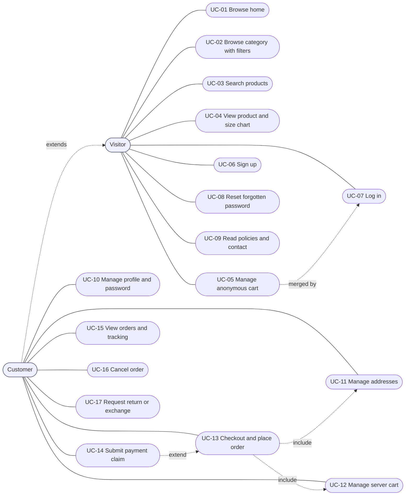
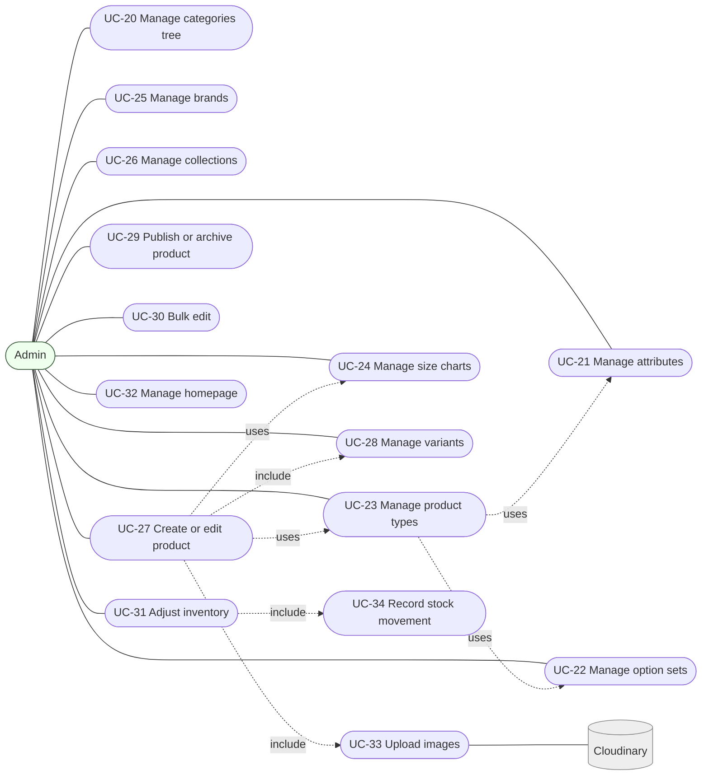
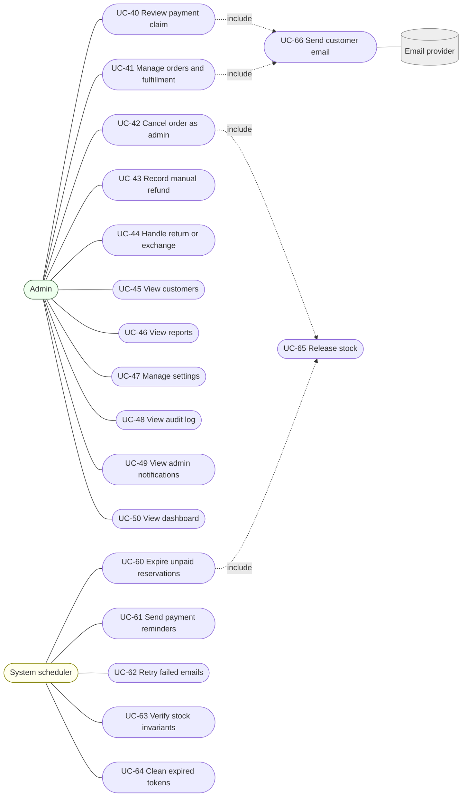

# 03 — USE CASES

Actors: **Visitor**, **Customer** (extends Visitor), **Admin**, **System** (scheduler/email), **Cloudinary** and **Email provider** (external).

## 1. Use case diagrams (Mermaid)

Mermaid has no native UML use-case notation; actors are rounded boxes and use cases are stadium shapes.

### 1.1 Visitor and Customer

### 1.2 Admin — catalog and inventory

### 1.3 Admin — operations, and System

## 2. Use case index

| ID | Name | Actor | FR refs |
|---|---|---|---|
| UC-01 | Browse home | Visitor | FR-SF-001 |
| UC-02 | Browse category with filters | Visitor | FR-SF-002, 003 |
| UC-03 | Search products | Visitor | FR-SF-004 |
| UC-04 | View product and size chart | Visitor | FR-SF-005..008, FR-SC-005 |
| UC-05 | Manage anonymous cart | Visitor | FR-CART-002 |
| UC-06 | Sign up | Visitor | FR-AUTH-001..003 |
| UC-07 | Log in | Visitor | FR-AUTH-004, FR-CART-002 |
| UC-08 | Reset forgotten password | Visitor | FR-AUTH-007, 008 |
| UC-09 | Read policies and contact | Visitor | FR-SF-011 |
| UC-10 | Manage profile and password | Customer | FR-AUTH-009, 010 |
| UC-11 | Manage addresses | Customer | FR-AUTH-011 |
| UC-12 | Manage server cart | Customer | FR-CART-001..004 |
| UC-13 | Checkout and place order | Customer | FR-CHK-001..007 |
| UC-14 | Submit payment claim | Customer | FR-PAY-001..004 |
| UC-15 | View orders and tracking | Customer | FR-ORD-001 |
| UC-16 | Cancel order | Customer | FR-ORD-002 |
| UC-17 | Request return or exchange | Customer | FR-RET-001, 002 |
| UC-20..26 | Catalog builder CRUD | Admin | FR-CAT, FR-ATTR, FR-OPT, FR-PT, FR-SC, FR-BR, FR-COL |
| UC-27..30 | Product management | Admin | FR-PRD |
| UC-31 | Adjust inventory | Admin | FR-INV |
| UC-32 | Manage homepage | Admin | FR-ADM-006 |
| UC-40 | Review payment claim | Admin | FR-PAY-005..008 |
| UC-41 | Manage orders and fulfillment | Admin | FR-ORD-003..007 |
| UC-42 | Cancel order as admin | Admin | FR-ORD-008, 009 |
| UC-43 | Record manual refund | Admin | FR-ORD-009, FR-RET-005 |
| UC-44 | Handle return or exchange | Admin | FR-RET-003..007 |
| UC-45..50 | Customers, reports, settings, audit, notifications, dashboard | Admin | FR-ADM, FR-REP |
| UC-60..65 | Scheduled jobs | System | FR-SYS-002 |

## 3. Detailed use case descriptions

Template: **Actor · Preconditions · Trigger · Main flow · Alternate/exception flows · Postconditions · Rules.**

---

### UC-04 View product and size chart
- **Actor:** Visitor/Customer
- **Preconditions:** Product is `published`, its category is `active`.
- **Trigger:** Opens `/products/:slug`.
- **Main flow:**
  1. System returns product, active variants, effective prices, availability per variant, resolved size chart (if any).
  2. User selects option values (size button, color swatch).
  3. UI updates price, image, availability for the chosen combination.
  4. User opens Size Chart popup; the selected size row is highlighted.
  5. User clicks Add to cart.
- **Alternate flows:**
  - A1. Some option value has no available variant → shown disabled with "Unavailable" text.
  - A2. Required option not selected → Add to cart blocked with message "Select size".
  - A3. Old slug → 301 to current slug. Draft/archived/unknown → 404.
- **Postconditions:** Line added to cart (anonymous: localStorage; logged in: server).
- **Rules:** BR-SIZE-01, BR-PRICE-01.

### UC-05 / UC-07 Anonymous cart and login merge
- **Preconditions:** Visitor has items in localStorage cart.
- **Main flow:** Visitor logs in → client calls `POST /cart/merge` with lines → server validates each variant (active, published), sums quantities with existing server cart, caps by `maxQtyPerLine` and available stock → returns merged cart with an `adjustments[]` list → client clears localStorage cart.
- **Alternate:** Variant no longer available → line dropped and listed in `adjustments`.
- **Postconditions:** Server cart is the single source for the user.

### UC-06 Sign up
- **Main flow:** Enter name, email, phone, password → validation → create user with role `customer` → log in (cookies) → welcome redirect.
- **Alternate:** Email exists → `EMAIL_ALREADY_REGISTERED`. Weak password / invalid phone → validation errors. Rate limit → 429.
- **Rules:** Role cannot be supplied by client.

### UC-08 Reset forgotten password
- **Main flow:** Visitor submits email → system always responds neutral success → if user exists: create token (hash stored, 60 min), queue reset email → user opens link, submits new password with token → system validates, updates password, marks token used, revokes sessions.
- **Alternate:** Invalid/expired/used token → `INVALID_RESET_TOKEN`.

### UC-13 Checkout and place order
- **Actor:** Customer
- **Preconditions:** Logged in; cart not empty; ≥ 1 saved address (or enters one inline).
- **Trigger:** Clicks Checkout.
- **Main flow:**
  1. System calls quote: re-prices lines, validates availability, resolves delivery zone and fee, computes totals.
  2. Customer confirms contact name/phone, address, optional note, chooses payment method.
  3. Customer ticks policy acceptance, clicks Place order (client sends `Idempotency-Key`).
  4. System in one transaction: atomically reserves stock for every line, creates order (`pending`, payment `not_submitted`) with snapshots, creates reservation (`expiresAt = now + 24h`), writes stock movements and order event, increments order counter.
  5. System clears purchased lines from the cart; queues "order placed" email and admin notification.
  6. Customer sees order number, amount due, wallet instructions, deadline, and the payment claim form.
- **Alternate/exception flows:**
  - E1. Any line unavailable/insufficient → whole placement fails, `INSUFFICIENT_STOCK` with per-line details; nothing reserved.
  - E2. Price changed since cart view → quote shows the change; customer must re-confirm.
  - E3. No delivery zone → `NO_DELIVERY_ZONE`.
  - E4. Duplicate request (same Idempotency-Key) → returns original order, no second reservation.
  - E5. Concurrent buyer takes the last unit → loser gets E1.
- **Postconditions:** Order exists; stock `reserved` increased; cart updated.
- **Rules:** BR-PRICE-01, BR-STK-01, BR-ORD-02.

### UC-14 Submit payment claim
- **Actor:** Customer
- **Preconditions:** Own order; status `pending`; payment `not_submitted` or `rejected`; reservation active and not expired; resubmission limit not exceeded.
- **Main flow:** Customer pays via wallet app outside the site → enters method, transaction ID, sender phone, amount → system validates and creates claim `under_review` (attemptNo +1) → order payment `under_review`, reservation `on_hold_review` → queues admin notification and (optional) acknowledgment email.
- **Alternate flows:**
  - A1. Duplicate active transaction ID → `DUPLICATE_TRANSACTION_ID`.
  - A2. Order expired/cancelled → `ORDER_NOT_PAYABLE`.
  - A3. Limit exceeded → `CLAIM_LIMIT_REACHED`.
- **Postconditions:** Claim awaiting admin decision; stock stays reserved without expiry.
- **Rules:** BR-PAY-01.

### UC-16 Cancel order (customer)
- **Preconditions:** Own order with status `pending` or `confirmed`.
- **Main flow:** Customer selects reason → system cancels: if payment not confirmed → release reservation; if payment confirmed → restock `onHand` and set payment `refund_due` → event, email, admin notification.
- **Alternate:** Status `processing` or later → `INVALID_TRANSITION` (suggest contacting support / return).
- **Rules:** BR-ORD-03.

### UC-17 Request return or exchange
- **Preconditions:** Own order `delivered`; within return window; quantity available to return.
- **Main flow:** Select items/quantities, type (return or exchange), reason; for exchange choose a different variant of the same product → system creates request `requested`, notifies admin.
- **Alternate:** Window expired → `RETURN_WINDOW_EXPIRED`. Exchange variant unavailable → `INSUFFICIENT_STOCK`.

### UC-20..26 Catalog builder CRUD (standard admin CRUD)
Applies to Category, Attribute, Option Set, Product Type, Size Chart, Brand, Collection.
- **Actor:** Admin
- **Main flow:** List (search, filter by status) → create/edit form with validation → save → audit event → storefront cache revalidated.
- **Alternate flows:** Duplicate name/key/slug → validation error. Delete requested on used entity → `ENTITY_IN_USE`, offer Archive. Category move violating depth/leaf rules → `CATEGORY_DEPTH_EXCEEDED` / `CATEGORY_HAS_PRODUCTS`.
- **Specifics:**
  - **UC-20 Categories:** tree view with drag-and-drop; set Product Type and Size Chart per node; inheritance shown ("inherited from Men").
  - **UC-23 Product Types:** choose attributes (required/optional) and option sets; toggle size chart; shows count of products using the type.
  - **UC-24 Size Charts:** add columns (label, key), add rows (size + values); preview table; attach to categories.

### UC-27 Create or edit product (with UC-28, UC-33)
- **Actor:** Admin
- **Preconditions:** At least one leaf category with a Product Type exists.
- **Main flow:**
  1. Admin → Products → Add Product; chooses a leaf category; form renders from its Product Type.
  2. Enters name, slug, description, brand, collections, attributes.
  3. Uploads images (signed direct upload to Cloudinary); orders them; sets main image, alt text, optional color association.
  4. Sets regular price and optional sale price/dates.
  5. Selects option sets and values; system generates combinations; admin removes unsold ones.
  6. For each variant: SKU, stock, price override, threshold override, optional image; uses bulk-apply.
  7. Optionally selects a size chart override.
  8. Previews storefront page and tests selections.
  9. Saves as draft, or publishes (checklist enforced).
- **Alternate flows:**
  - A1. Duplicate SKU → `SKU_ALREADY_EXISTS`.
  - A2. Publish checklist failure → `PUBLISH_CHECKLIST_FAILED` with failing items.
  - A3. Upload rejected (type/size) → inline error.
  - A4. Product type has no option sets → single default variant created automatically (e.g. a saree with only color uses the color option; a product with no options gets one default variant).
- **Postconditions:** Product and variants saved; `stockMovements(initial)` recorded; denormalized fields recomputed; audit event written.

### UC-29 Publish or archive product
- **Main flow:** Admin clicks Publish → checklist passes → status `published`. Archive → status `archived`, hidden from storefront; existing orders unaffected; collections reference dropped from storefront.
- **Alternate:** Checklist fails → list of problems.

### UC-31 Adjust inventory
- **Main flow:** Admin opens Inventory → selects variant → enters delta or new onHand → chooses reason (+note) → system validates `onHand ≥ reserved` → updates atomically → writes stock movement → recomputes `inStock` → possibly raises/clears low-stock notification.
- **Alternate:** Resulting `onHand < reserved` → `STOCK_BELOW_RESERVED`.

### UC-40 Review payment claim
- **Actor:** Admin
- **Preconditions:** Claim `under_review`.
- **Main flow (confirm):**
  1. Admin opens claim, checks wallet statement externally.
  2. Enters received amount (default = claimed) and optional note; clicks Confirm.
  3. System transaction: claim `confirmed`; order payment `confirmed`; order `pending → confirmed`; for each line `onHand -= qty`, `reserved -= qty`; reservation `consumed`; `collectedAmount` stored; stock movements (`sale`); order events; audit event.
  4. System queues "payment confirmed" email.
- **Alternate flows:**
  - A1. Reject: reason required → claim `rejected`; order payment `rejected`; reservation window restarts (24h); email with reason and resubmission info; if resubmissions exhausted → auto-cancel (`claims_exhausted`) and release stock.
  - A2. Received amount ≠ order total → `AMOUNT_MISMATCH` unless a note is provided; stored as-is.
  - A3. Order already cancelled/expired when confirming → `ORDER_NOT_PAYABLE`; admin must handle manually (record refund if money arrived).
  - A4. Two admins decide simultaneously → second gets `CLAIM_ALREADY_DECIDED`.
- **Postconditions:** Immutable decision record with actor/time.

### UC-41 Manage orders and fulfillment
- **Main flow:** Admin searches/filter orders → opens order → moves status `confirmed → processing → shipped (courier, tracking) → delivered`; adds internal or customer-visible notes.
- **Alternate:** Invalid transition → `INVALID_TRANSITION`. `processing` requires payment `confirmed`.
- **Postconditions:** Events appended; customer emails for `shipped`/`delivered`; `deliveredAt` set on delivered.

### UC-42 Cancel order as admin
- **Main flow:** Admin chooses Cancel (statuses `pending`, `confirmed`, `processing`) → mandatory reason → system applies BR-ORD-03 (release reservation or restock; payment `refund_due` if it was confirmed) → event, email.

### UC-43 Record manual refund
- **Preconditions:** Order `paymentStatus = refund_due`.
- **Main flow:** Admin sends money externally → records amount, method, reference, note → system sets payment `refunded`, appends refund record and event, audit, email.
- **Alternate:** Amount > collected amount → `REFUND_EXCEEDS_COLLECTED`.

### UC-44 Handle return or exchange
- **Main flow:** Review request → approve (or reject with reason / request info) → customer ships goods → admin marks `received` → records inspection per item (accepted/rejected, restock yes/no) → system restocks accepted items (`return_restock`) → resolution: refund (UC-43) or exchange (exchange variant reserved on approval, consumed on dispatch with tracking) → mark `completed`.
- **Alternate:** Inspection rejected → no restock, resolution none or partial; customer notified with note.
- **Rules:** BR-RET-01 (never restock before inspection).

### UC-46 View reports
- **Main flow:** Admin chooses date range (default last 30 days) and optional compare → system aggregates per BR-REP-01 in `Asia/Dhaka` → shows tables/charts with range and timezone labels.

### UC-47 Manage settings
- **Main flow:** Edit store info, thresholds, hold hours, resubmission limit, return window, delivery zones, wallet methods, notification emails, static pages → validation → save → audit → effective immediately.

### UC-60 Expire unpaid reservations (System)
- **Trigger:** Every 5 minutes.
- **Main flow:** Acquire job lease → find reservations `active` with `expiresAt ≤ now` → for each, in a transaction: release `reserved`, reservation `released`, order `pending → cancelled` (`payment_timeout`), events, stock movements (`release`) → queue "order expired" email.
- **Alternate:** Reservation changed meanwhile (claim submitted) → condition fails; skip. Re-running is harmless.

### UC-61 Send payment reminders (System)
- **Trigger:** Every 15 minutes. Find active reservations with `expiresAt − now ≤ 2h` and `reminderSentAt` null and payment `not_submitted` → queue reminder email → set `reminderSentAt`.

### UC-62 Retry failed emails (System)
- **Trigger:** Every 5 minutes. Pick `emailLogs` with `status=failed`, `attempts < 5`, `nextRetryAt ≤ now` → resend with exponential backoff.

### UC-63 Verify stock invariants (System)
- **Trigger:** Nightly. Query variants violating `onHand ≥ 0`, `reserved ≥ 0`, `reserved ≤ onHand`, and reservations vs `reserved` totals → alert admin.
