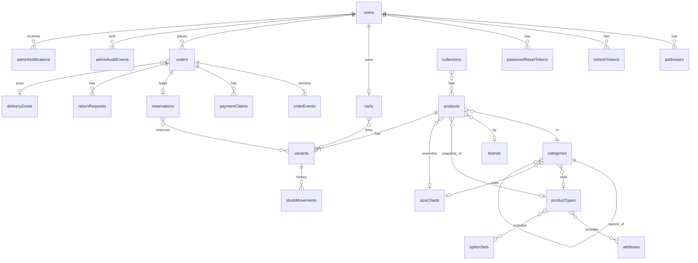

# 04 — DATABASE MODEL (MongoDB)

Conventions: `_id: ObjectId` on every document · `createdAt`, `updatedAt: Date` on every collection unless noted · money = integer poisha (TD-01) · enums defined in file 00 §6 · `?` = optional · `→` = reference to another collection.
MongoDB Atlas replica set with transactions is required.

## 1. ER diagram



## 2. Collections

### 2.1 users
```ts
{
  name: string
  email: string               // lowercase, unique
  phone: string               // normalized 01XXXXXXXXX
  passwordHash: string
  role: Role                  // default 'customer'
  status: UserStatus          // default 'active'
  profileImage?: { publicId: string, url: string }
  emailVerifiedAt?: Date      // reserved (TD-11)
  lastLoginAt?: Date
  tokenVersion: number        // increment to revoke all sessions
}
```
Indexes: `{email:1}` unique · `{phone:1}` · `{role:1,status:1}` · text-like search via `{name:1}`.

### 2.2 addresses
```ts
{ userId → users, label: string, recipientName: string, phone: string,
  division: string, district: string, area: string, addressLine: string,
  postalCode?: string, isDefault: boolean }
```
Indexes: `{userId:1}` · partial unique `{userId:1,isDefault:1}` where `isDefault:true` (one default per user). Max 10 per user enforced in service.

### 2.3 refreshTokens
```ts
{ userId → users, tokenHash: string, familyId: string, expiresAt: Date,
  revokedAt?: Date, replacedBy?: ObjectId, userAgent?: string, ip?: string }
```
Indexes: `{tokenHash:1}` unique · `{userId:1}` · `{familyId:1}` · TTL `{expiresAt:1}` with `expireAfterSeconds: 604800`.

### 2.4 passwordResetTokens
```ts
{ userId → users, tokenHash: string, expiresAt: Date, usedAt?: Date }
```
Indexes: `{tokenHash:1}` unique · `{userId:1}` · TTL `{expiresAt:1}` `expireAfterSeconds: 604800`.

### 2.5 categories
```ts
{
  name: string
  slug: string                // unique
  slugHistory: string[]
  parentId?: → categories
  path: ObjectId[]            // ancestors root→parent
  level: 1 | 2 | 3
  order: number               // sibling order
  image?: Media
  banner?: Media
  description?: string
  seo?: { title?: string, description?: string }
  productTypeId?: → productTypes     // inherited if absent
  sizeChartId?: → sizeCharts         // inherited if absent
  audience?: Audience
  status: ActiveStatus
  hasChildren: boolean               // denormalized
  productCount: number               // denormalized (published products)
}
// Media = { publicId: string, url: string, width?: number, height?: number, alt?: string }
```
Indexes: `{slug:1}` unique · `{parentId:1,order:1}` · `{path:1}` · `{status:1,level:1}` · `{slugHistory:1}`.

### 2.6 attributes
```ts
{
  name: string
  key: string                 // unique, lowercase snake_case, immutable once used
  inputType: AttributeInputType
  options?: { value: string, label: string, colorHex?: string, order: number, hidden?: boolean }[]
  unit?: string               // e.g. 'mAh', 'inch'
  isFilterable: boolean
  status: ActiveStatus
}
```
Indexes: `{key:1}` unique · `{status:1}`.

### 2.7 optionSets
```ts
{
  name: string
  key: string                 // unique: 'size','color','storage','age'
  type: OptionSetType
  values: { value: string, label: string, colorHex?: string, order: number, hidden?: boolean }[]
  status: ActiveStatus
}
```
Indexes: `{key:1}` unique.

### 2.8 productTypes
```ts
{
  name: string
  key: string                 // unique
  attributes: { attributeId → attributes, required: boolean, order: number, hidden?: boolean }[]
  optionSetIds: { optionSetId → optionSets, order: number, hidden?: boolean }[]
  sizeChartEnabled: boolean
  status: ActiveStatus
}
```
Indexes: `{key:1}` unique.

### 2.9 sizeCharts
```ts
{
  name: string
  unit: 'inch' | 'cm' | 'none'
  columns: { key: string, label: string }[]          // admin-defined, ordered
  rows: { size: string, values: Record<string, string | number> }[]   // keys = columns[].key
  status: ActiveStatus
}
```
Indexes: `{name:1}` · `{status:1}`. Row `size` values are matched to the `size` option set values (case-insensitive trim).

### 2.10 brands
```ts
{ name: string, slug: string, logo?: Media, description?: string, status: ActiveStatus, productCount: number }
```
Indexes: `{slug:1}` unique · `{status:1}`.

### 2.11 collections
```ts
{
  name: string
  slug: string                // unique
  type: 'manual'              // 'rule' reserved (A-01)
  banner?: Media
  description?: string
  productIds: ObjectId[]      // ordered → products
  startsAt?: Date
  endsAt?: Date
  status: ActiveStatus
}
```
Indexes: `{slug:1}` unique · `{status:1,startsAt:1,endsAt:1}`. Also products hold `collectionIds` for fast filtering (kept in sync by service).

### 2.12 products
```ts
{
  name: string
  slug: string                // unique
  slugHistory: string[]
  productCode?: string
  description: string         // sanitized HTML or Markdown
  categoryId → categories     // leaf
  categoryPath: ObjectId[]    // denormalized ancestors + leaf (for subtree queries)
  brandId?: → brands
  productTypeId → productTypes   // type at creation; drives form
  collectionIds: ObjectId[]
  attributeValues: { key: string, value: string | number | boolean | string[] }[]
  images: { publicId: string, url: string, width: number, height: number, alt?: string, order: number, isMain: boolean, optionValue?: { optionKey: string, value: string } }[]
  regularPrice: number        // poisha
  salePrice?: number
  saleStartsAt?: Date
  saleEndsAt?: Date
  optionKeys: string[]        // option set keys used by this product, e.g. ['size','color']
  optionValuesUsed: { optionKey: string, values: string[] }[]   // for filters/UI
  sizeChartId?: → sizeCharts  // product-level override
  isFeatured: boolean
  tags: string[]
  seo?: { title?: string, description?: string }
  status: PublishStatus
  publishedAt?: Date
  // denormalized listing fields (FR-PRD-015)
  minPrice: number            // lowest effective unit price across active variants
  maxPrice: number
  inStock: boolean            // any active variant with available > 0
  searchText: string          // name + brand + category names + attribute values + tags
  stats: { unitsSold: number, viewCount?: number }
}
```
Indexes:
- `{slug:1}` unique · `{slugHistory:1}`
- `{status:1,categoryPath:1,createdAt:-1}` (category listing, newest)
- `{status:1,categoryPath:1,minPrice:1}` (price sort/filter)
- `{status:1,brandId:1}` · `{status:1,collectionIds:1}` · `{status:1,isFeatured:1}`
- `{status:1,"attributeValues.key":1,"attributeValues.value":1}` (attribute filters)
- `{status:1,"optionValuesUsed.optionKey":1,"optionValuesUsed.values":1}` (option filters)
- text index on `searchText` (+ `name` weight 5)
- `{stats.unitsSold:-1}` partial where `status:'published'`

### 2.13 variants
```ts
{
  productId → products
  sku: string                 // unique, uppercase
  barcode?: string
  optionValues: { optionKey: string, value: string }[]   // [] for default variant
  optionHash: string          // sorted 'size=L|color=Black' — unique per product
  price?: number              // override of regular price
  salePrice?: number          // override of sale price
  image?: Media
  stock: { onHand: number, reserved: number }   // invariants: 0 ≤ reserved ≤ onHand
  lowStockThreshold?: number
  lowStockNotified: boolean
  isActive: boolean
}
```
Indexes: `{sku:1}` unique · `{productId:1,optionHash:1}` unique · `{productId:1,isActive:1}` · `{isActive:1,"stock.onHand":1}` (inventory screens).
Available = `stock.onHand − stock.reserved` (computed, never stored).

### 2.14 carts (logged-in users only)
```ts
{ userId → users (unique), items: { variantId → variants, quantity: number, addedAt: Date }[] }
```
Indexes: `{userId:1}` unique. Prices are never stored in carts.

### 2.15 deliveryZones
```ts
{
  name: string
  districts: string[]               // matched case-insensitively against address.district
  fee: number                       // poisha
  freeDeliveryThreshold?: number    // poisha; subtotal ≥ → fee 0
  estimatedDaysMin?: number
  estimatedDaysMax?: number
  isDefault: boolean                // exactly one default allowed
  status: ActiveStatus
}
```
Indexes: `{status:1}` · partial unique `{isDefault:1}` where `isDefault:true`.

### 2.16 orders
```ts
{
  orderNumber: string              // 'ORD-000123' unique
  userId → users
  idempotencyKey: string           // unique per user
  status: OrderStatus
  paymentStatus: PaymentStatus
  paymentMethod: WalletMethod
  items: {
    productId, variantId, sku: string, productName: string, productSlug: string,
    brandName?: string, categoryName?: string,
    optionValues: { optionKey: string, optionLabel: string, value: string }[],
    image?: { url: string, publicId?: string },
    unitPrice: number, regularPrice: number, quantity: number, lineTotal: number
  }[]                              // immutable snapshot
  contact: { name: string, phone: string }
  shippingAddress: { recipientName, phone, division, district, area, addressLine, postalCode? }   // snapshot
  deliveryZone: { id: ObjectId, name: string }
  customerNote?: string
  totals: { subtotal: number, discountTotal: number, deliveryFee: number, grandTotal: number }
  collectedAmount?: number         // set on payment confirmation
  paymentConfirmedAt?: Date
  claimCount: number               // claims submitted so far
  cancel?: { reason: CancelReason, note?: string, by: 'customer' | 'admin' | 'system', at: Date }
  shipping?: { courier?: string, trackingRef?: string, shippedAt?: Date }
  placedAt: Date
  confirmedAt?: Date
  deliveredAt?: Date
  refunds: { amount: number, method: string, reference?: string, note?: string, recordedBy → users, at: Date }[]
  policyAcceptedAt: Date
}
```
Indexes: `{orderNumber:1}` unique · `{userId:1,placedAt:-1}` · `{userId:1,idempotencyKey:1}` unique · `{status:1,placedAt:-1}` · `{paymentStatus:1,placedAt:-1}` · `{paymentConfirmedAt:1}` · `{placedAt:-1}` · `{"contact.phone":1}`.

### 2.17 paymentClaims
```ts
{
  orderId → orders, userId → users
  attemptNo: number
  method: WalletMethod
  transactionId: string            // normalized UPPERCASE
  senderPhone: string
  claimedAmount: number            // poisha
  status: ClaimStatus
  reviewedBy?: → users
  reviewedAt?: Date
  receivedAmount?: number          // admin-entered on confirm
  decisionNote?: string
  rejectionReason?: string
}
```
Indexes: `{orderId:1,attemptNo:1}` unique · `{status:1,createdAt:1}` (review queue) · **partial unique** `{method:1,transactionId:1}` where `status ∈ ['under_review','confirmed']` · `{userId:1,createdAt:-1}`.

### 2.18 reservations
```ts
{
  orderId → orders (unique)
  items: { variantId → variants, quantity: number }[]
  status: ReservationStatus
  expiresAt?: Date                 // null while on_hold_review/consumed/released
  reminderSentAt?: Date
}
```
Indexes: `{orderId:1}` unique · `{status:1,expiresAt:1}` (expiry job) .

### 2.19 orderEvents (append-only)
```ts
{
  orderId → orders
  type: 'placed'|'status_changed'|'payment_claim_submitted'|'payment_confirmed'|'payment_rejected'|'note'|'cancelled'|'refund_recorded'|'shipped'|'delivered'|'expired'
  fromStatus?: string, toStatus?: string
  visibility: Visibility
  note?: string
  actor: { type: 'customer'|'admin'|'system', userId?: ObjectId }
}
```
Indexes: `{orderId:1,createdAt:1}`.

### 2.20 returnRequests
```ts
{
  returnNumber: string             // 'RET-000045' unique
  orderId → orders, userId → users
  type: ReturnType
  items: { variantId, sku, productName, quantity: number, reason: string, exchangeVariantId?: → variants }[]
  reasonNote?: string
  status: ReturnStatus
  messages: { from: 'customer'|'admin', text: string, at: Date }[]
  decision?: { by → users, at: Date, action: 'approved'|'rejected', note?: string }
  shippingResponsibility?: 'customer' | 'store'
  receivedAt?: Date
  inspection?: { by → users, at: Date, items: { variantId, result: 'accepted'|'rejected', restock: boolean, note?: string }[] }
  resolution?: { type: 'refund'|'exchange'|'none', refundAmount?: number, exchangeTrackingRef?: string, note?: string }
  completedAt?: Date
}
```
Indexes: `{returnNumber:1}` unique · `{orderId:1}` · `{userId:1,createdAt:-1}` · `{status:1,createdAt:-1}`.

### 2.21 stockMovements (append-only)
```ts
{
  variantId → variants, productId → products, sku: string
  type: StockMovementType
  delta: number                    // change to onHand or reserved (see 'field')
  field: 'onHand' | 'reserved'
  before: number, after: number
  reason?: string                  // adjustment reasons
  note?: string
  orderId?: → orders, returnId?: → returnRequests
  actor: { type: 'admin'|'system'|'customer', userId?: ObjectId }
}
```
Indexes: `{variantId:1,createdAt:-1}` · `{orderId:1}` · `{type:1,createdAt:-1}`.

### 2.22 emailLogs
```ts
{
  type: string                     // 'password_reset','order_placed',...
  to: string
  subject: string
  status: EmailStatus
  attempts: number
  lastError?: string
  nextRetryAt?: Date
  relatedType?: 'order'|'user'|'return'
  relatedId?: ObjectId
  payload?: object                 // template variables only; no secrets/tokens in plaintext
  sentAt?: Date
}
```
Indexes: `{status:1,nextRetryAt:1}` · `{relatedId:1}` · TTL `{createdAt:1}` 90 days.

### 2.23 adminNotifications
```ts
{ type: AdminNotifType, title: string, body?: string, refType?: string, refId?: ObjectId, readBy: ObjectId[] }
```
Indexes: `{createdAt:-1}` · `{type:1,createdAt:-1}`.

### 2.24 adminAuditEvents (append-only)
```ts
{
  actorId → users
  action: string                   // e.g. 'product.publish','payment.confirm','stock.adjust','settings.update'
  targetType: string, targetId?: ObjectId
  before?: object, after?: object  // changed fields only
  ip?: string, userAgent?: string
}
```
Indexes: `{createdAt:-1}` · `{actorId:1,createdAt:-1}` · `{targetType:1,targetId:1}` · TTL optional 2 years.

### 2.25 settings (singleton, `key: 'store'`)
```ts
{
  key: 'store'
  storeName: string, logo?: Media, contactEmail: string, contactPhone: string, address?: string
  timezone: 'Asia/Dhaka'
  currency: 'BDT'
  lowStockThreshold: number          // default 5
  reservationHoldHours: number       // default 24
  maxClaimResubmissions: number      // default 3
  returnWindowDays: number           // default 7
  maxQtyPerLine: number              // default 10
  paymentMethods: { method: WalletMethod, accountNumber: string, accountType: 'personal'|'merchant'|'agent', instructions: string, active: boolean }[]
  adminNotificationEmails: string[]
}
```
Indexes: `{key:1}` unique.

### 2.26 pages
```ts
{ slug: string, title: string, body: string, status: 'draft'|'published', seo?: object }
```
Seeds: `delivery-policy`, `return-policy`, `privacy-policy`, `terms`, `about`, `contact`. Index `{slug:1}` unique.

### 2.27 homepageSections
```ts
{
  type: 'hero_banner' | 'category_grid' | 'product_carousel' | 'promo_banner'
  title?: string
  order: number
  config: {
    // hero_banner / promo_banner: slides: { image: Media, link?: string, heading?: string, subheading?: string, ctaLabel?: string }[]
    // category_grid: categoryIds: ObjectId[]
    // product_carousel: source: 'new_arrivals'|'featured'|'sale'|'collection', collectionId?: ObjectId, limit: number
  }
  startsAt?: Date, endsAt?: Date
  status: ActiveStatus
}
```
Indexes: `{status:1,order:1}`.

### 2.28 counters
```ts
{ _id: 'order' | 'return', seq: number }
```
Incremented with `findOneAndUpdate({_id}, {$inc:{seq:1}}, {upsert:true, returnDocument:'after'})` inside the order transaction.

### 2.29 jobLeases
```ts
{ _id: string /* job name */, lockedBy: string, lockedUntil: Date }
```
Used for single-runner scheduled jobs (NFR-SCAL-002).

## 3. Relations summary

| From | To | Type | Notes |
|---|---|---|---|
| categories.parentId | categories | N:1 | Tree, max depth 3 |
| categories.productTypeId / sizeChartId | productTypes / sizeCharts | N:1 optional | Inherited from nearest ancestor |
| productTypes.attributes[] / optionSetIds[] | attributes / optionSets | N:M | Embedded refs with order/required |
| products.categoryId | categories | N:1 | Leaf only |
| products.brandId | brands | N:1 optional | |
| products ↔ collections | N:M | Stored both ways (`collections.productIds`, `products.collectionIds`) |
| variants.productId | products | N:1 | Every product ≥ 1 variant |
| carts.items.variantId | variants | N:M | Logged-in users only |
| orders.userId | users | N:1 | |
| orders.items.* | — | snapshot | No live references needed to render history |
| paymentClaims.orderId | orders | N:1 | |
| reservations.orderId | orders | 1:1 | |
| stockMovements.variantId | variants | N:1 | |
| returnRequests.orderId | orders | N:1 | |

## 4. Invariants (enforced in services + verified nightly)

1. `0 ≤ variants.stock.reserved ≤ variants.stock.onHand`.
2. Every product has ≥ 1 variant; published products have ≥ 1 active variant.
3. A category has either children or products, never both.
4. Category depth ≤ 3; `level = path.length + 1`.
5. `orders.totals.grandTotal = subtotal − discountTotal + deliveryFee` and `subtotal = Σ items.lineTotal`.
6. Sum of `reservations.items.quantity` over `active`/`on_hold_review` reservations per variant equals `variants.stock.reserved` (minus nothing else reserves in R1 except approved exchanges, which also create reservations).
7. At most one active claim per `(method, transactionId)`.
8. `orderNumber`, `sku`, `email`, `slug` unique.
9. Order `status = confirmed|processing|shipped|delivered` implies `paymentStatus ∈ {confirmed, refund_due, refunded}` (never `not_submitted/under_review/rejected`).

## 5. Seed data (installation)

- Option sets: `size` (XS,S,M,L,XL,XXL,3XL), `color` (Black, White, Red, Blue, Green, Yellow, Gray, Navy, Brown, Pink with hex), `age` (0-6M, 6-12M, 1-2Y, 2-3Y, 3-4Y, 4-5Y, 5-6Y, 6-8Y, 8-10Y, 10-12Y).
- Attributes: `material`, `fit`, `care`, `fabric`, `work_type`, `length_hand`, `blouse_piece` (boolean).
- Product types: `apparel`, `saree`, `kids-apparel` (FR-PT-005).
- Delivery zones: "Inside Dhaka", "Outside Dhaka" (default).
- Pages: policy pages (placeholder text).
- Settings document with defaults; payment methods inactive until configured.
- Admin user: created by bootstrap script from `ADMIN_EMAIL`, `ADMIN_PASSWORD` env, never seeded with a fixed password.
