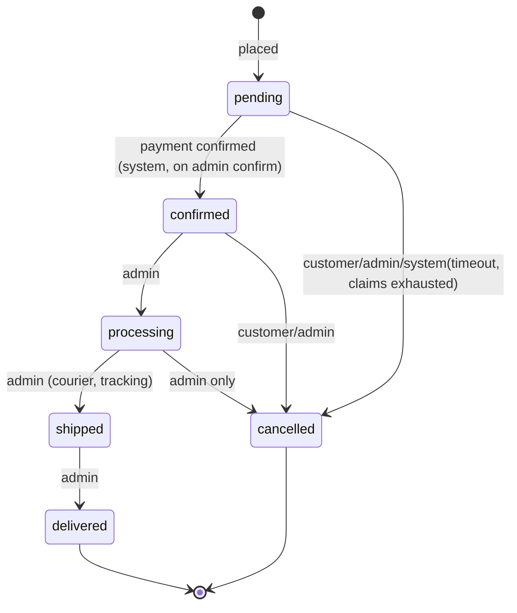
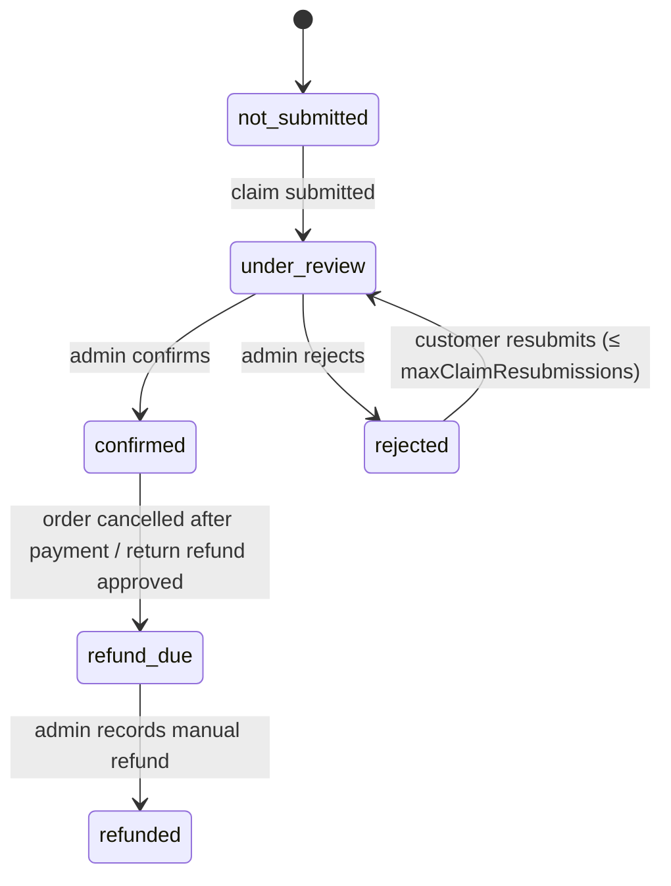
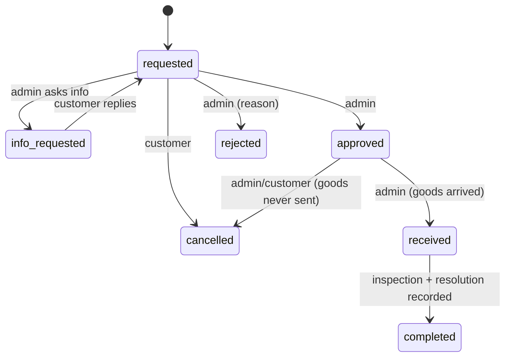

# 06 — BUSINESS RULES, STATE MACHINES AND ALGORITHMS

All rules here are binding. Rule IDs are referenced from files 01 and 03.

## 1. Category and catalog rules

**BR-CAT-01 Inheritance resolution.** For a category `C`: `productType(C) = C.productTypeId ?? productType(parent(C)) ?? null`. Same for `sizeChart`. A leaf category without a resolvable Product Type cannot receive products (`VALIDATION_ERROR: productType required`).

**BR-CAT-02 Tree rules.** `level = path.length + 1`, max 3. Products only on leaf categories (no children). Adding a child to a category with products is rejected (`CATEGORY_HAS_PRODUCTS`). Moving a subtree must keep all descendants ≤ level 3.

**BR-CAT-03 Slug rules.** Lowercase ASCII, digits, hyphens; auto-generated from name (transliteration for Bangla names is not guaranteed — admin must provide a slug when generation yields empty). Unique per collection. On slug change push old slug to `slugHistory`; public lookup by old slug returns redirect.

**BR-SIZE-01 Size chart resolution.** `chart = product.sizeChartId ?? sizeChart(category)`; if `productType.sizeChartEnabled = false` → `null`. Row matching: compare `variant size value` to `row.size` after trim + case-insensitive.

**BR-VAR-01 Variants.** `optionHash` = sorted `optionKey=value` pairs joined by `|` (empty string for default variant). Unique per product. SKU stored uppercase, trimmed, allowed `[A-Z0-9-_]`, 3–40 chars. Suggested SKU = `productCode?-VALUE1-VALUE2` uppercased with non-alphanumerics removed.

**BR-VAR-02 Default variant.** Product with `optionKeys = []` has exactly one variant with `optionValues = []`.

## 2. Pricing

**BR-PRICE-01 Effective price for a variant at time `t`:**
```
regular = variant.price ?? product.regularPrice
saleCandidate = variant.salePrice ?? product.salePrice
saleActive = saleCandidate != null
             && saleCandidate < regular
             && (product.saleStartsAt == null || t >= product.saleStartsAt)
             && (product.saleEndsAt   == null || t <= product.saleEndsAt)
unitPrice = saleActive ? saleCandidate : regular
```
(Sale dates live on the product and apply to variant sale overrides too.)

**Listing fields:** `minPrice/maxPrice` = min/max of `unitPrice` over active variants at recompute time; a scheduled job (every 15 min) recomputes products whose sale window started/ended since last run.

**BR-PRICE-02 Order totals:**
```
lineTotal = unitPrice * quantity
subtotal = Σ lineTotal
discountTotal = 0                     // Release 1
deliveryFee = (zone.freeDeliveryThreshold != null && subtotal >= zone.freeDeliveryThreshold) ? 0 : zone.fee
grandTotal = subtotal - discountTotal + deliveryFee
```
Sale price reductions are part of `unitPrice`, not `discountTotal`.

**BR-PRICE-03 Delivery zone resolution.** Match `address.district` (trim, case-insensitive) against active zones' `districts`; if none, use the active default zone; if none, `NO_DELIVERY_ZONE`.

## 3. Stock and reservation

**BR-STK-01 Atomic reserve (per variant, inside the order transaction):**
```js
const r = await Variant.updateOne(
  { _id: variantId, isActive: true,
    $expr: { $gte: [ { $subtract: ['$stock.onHand', '$stock.reserved'] }, qty ] } },
  { $inc: { 'stock.reserved': qty } },
  { session });
if (r.modifiedCount !== 1) throw INSUFFICIENT_STOCK(variantId);
```
Order lines are processed in ascending `variantId` order to avoid deadlocks. If any line fails the whole transaction aborts.

**BR-STK-02 Stock movement logging.** Every change to `onHand` or `reserved` writes a `stockMovements` row in the same transaction with `before`/`after`.

**BR-STK-03 Stock effects by event**

| Event | `reserved` | `onHand` | Movement type |
|---|---|---|---|
| Order placed | +qty | — | reserve |
| Payment confirmed | −qty | −qty | sale |
| Reservation expired / claims exhausted / cancel before payment confirmed | −qty | — | release |
| Cancel after payment confirmed (status confirmed/processing, not shipped) | — | +qty | cancel_restock |
| Return accepted + restock | — | +qty | return_restock |
| Exchange approved (target variant) | +qty | — | reserve |
| Exchange dispatched | −qty | −qty | sale |
| Admin adjustment | — | ±qty | adjustment / initial |

**BR-STK-04 Low stock.** After any change, if `available ≤ threshold` and `lowStockNotified = false` → create admin notification + email and set `lowStockNotified = true`. When `available > threshold` set it back to `false`. Threshold = `variant.lowStockThreshold ?? settings.lowStockThreshold`.

**BR-STK-05 Product `inStock`.** Recomputed after stock/variant changes: true if any active variant has `available > 0`.

## 4. Order state machines

### 4.1 Order status



| From | To | Who | Preconditions | Side effects |
|---|---|---|---|---|
| (new) | pending | customer | stock reserved | reservation active; events; emails |
| pending | confirmed | system via claim confirm | claim confirmed | stock sale; `confirmedAt`; email |
| pending | cancelled | customer / admin / system | — | release reservation; email |
| confirmed | processing | admin | `paymentStatus = confirmed` | event |
| confirmed | cancelled | customer / admin | not shipped | restock `onHand`; `paymentStatus = refund_due`; email |
| processing | shipped | admin | — | `shipping.courier/trackingRef/shippedAt`; email |
| processing | cancelled | admin | reason + note | restock `onHand`; `paymentStatus = refund_due` |
| shipped | delivered | admin | — | `deliveredAt`; starts return window; email |

Any other transition → `INVALID_TRANSITION`. Every transition writes an `orderEvents` record (actor, from, to, note) and an audit event if by admin.

### 4.2 Payment status


Cancelled unpaid orders keep their last payment status (`not_submitted` or `rejected`).

### 4.3 Reservation status
`active` (expiresAt set) → `on_hold_review` (claim submitted; `expiresAt = null`) → `consumed` (payment confirmed). `on_hold_review → active` (claim rejected; `expiresAt = now + holdHours`). `active|on_hold_review → released` (cancel/expire).

### 4.4 Return request status


Inspection and resolution fields are set before `completed`.

## 5. Algorithms

### BR-ORD-02 Place order (single transaction)
```
1. Verify user active; require Idempotency-Key. If order exists for (userId,key) → return it.
2. Load server cart; reject empty.
3. For each line: load variant+product; require variant.isActive, product.status='published', category active;
   qty ≤ settings.maxQtyPerLine; compute unitPrice (BR-PRICE-01).
4. Load address (must belong to user); resolve zone (BR-PRICE-03); compute totals (BR-PRICE-02).
5. Require acceptPolicies = true and paymentMethod active.
6. START TRANSACTION
   a. Reserve each variant atomically (BR-STK-01), sorted by variantId.
   b. orderNumber = next('order').
   c. Insert order {status:'pending', paymentStatus:'not_submitted', items:snapshots, shippingAddress snapshot,
      totals, claimCount:0, placedAt:now, idempotencyKey}.
   d. Insert reservation {status:'active', expiresAt: now + holdHours, items}.
   e. Insert stockMovements(type:'reserve') and orderEvents('placed').
   f. Clear purchased lines from cart.
   COMMIT
7. After commit (best effort, async): email 'order_placed', admin notification 'new_order', low-stock checks.
```

### BR-PAY-01 Submit claim
```
Require: order.userId = me; order.status='pending'; order.paymentStatus ∈ {not_submitted, rejected};
         reservation.status ∈ {active} and (expiresAt > now); order.claimCount ≤ maxClaimResubmissions
         (i.e. total claims allowed = 1 + maxClaimResubmissions); method active.
Normalize transactionId (trim, uppercase); validate /^[A-Z0-9]{6,30}$/; senderPhone BD format; amount > 0.
TRANSACTION: insert claim {attemptNo: claimCount+1, status:'under_review'};
             order.paymentStatus='under_review'; order.claimCount++;
             reservation.status='on_hold_review', expiresAt=null;
             orderEvent('payment_claim_submitted'); adminNotification('payment_review').
Duplicate (method,transactionId) active → DUPLICATE_TRANSACTION_ID (partial unique index).
```

### BR-PAY-02 Confirm claim (admin)
```
Require claim.status='under_review' (conditional update) and order.status='pending'.
If receivedAmount != order.totals.grandTotal and note empty → AMOUNT_MISMATCH.
TRANSACTION:
  claim → confirmed {reviewedBy, reviewedAt, receivedAmount, decisionNote}
  order → status 'confirmed', paymentStatus 'confirmed', collectedAmount=receivedAmount,
          paymentConfirmedAt=now, confirmedAt=now
  for each reservation item: variant.stock.reserved -= qty AND variant.stock.onHand -= qty
       (conditional: reserved ≥ qty and onHand ≥ qty) ; stockMovements(type 'sale')
  reservation → consumed ; product.stats.unitsSold += qty
  orderEvents('payment_confirmed','status_changed') ; adminAuditEvent('payment.confirm')
After commit: email 'payment_confirmed'.
```

### BR-PAY-03 Reject claim (admin)
```
Require claim.status='under_review'; reason required.
TRANSACTION:
  claim → rejected {reason}; order.paymentStatus='rejected'
  if order.claimCount > maxClaimResubmissions  (no more attempts):
       cancel order (reason 'claims_exhausted') and release reservation (BR-ORD-03 unpaid path)
  else reservation → active with expiresAt = now + holdHours
  orderEvents; audit('payment.reject')
After commit: email 'payment_rejected' (includes reason and deadline, or cancellation notice).
```

### BR-ORD-03 Cancel order
```
Allowed: customer in {pending, confirmed}; admin in {pending, confirmed, processing}. Reason required (admin: note too).
TRANSACTION:
  if order.paymentStatus != 'confirmed' (unpaid path):
       reservation items: reserved -= qty ; reservation → released ; stockMovements('release')
       claims under_review (if any) → rejected with reason 'order_cancelled'
  else (paid path):
       each item: onHand += qty ; stockMovements('cancel_restock'); order.paymentStatus='refund_due'
  order.status='cancelled'; order.cancel={reason, note, by, at}; orderEvents; audit if admin
After commit: email 'order_cancelled'; adminNotification if customer cancelled a paid order.
```

### BR-JOB-01 Expire reservations (every 5 min, lease-protected)
```
find reservations {status:'active', expiresAt <= now} limit 100
for each (own transaction):
   conditional update reservation.status 'active' → 'released' (skip if modifiedCount=0)
   release reserved stock; order: pending → cancelled {reason:'payment_timeout', by:'system'}
   stockMovements('release'); orderEvents('expired')
after commit: email 'order_expired'
```

### BR-JOB-02 Payment reminder (every 15 min)
Reservations `active`, `reminderSentAt = null`, `expiresAt − now ≤ 2h`, order `paymentStatus='not_submitted'` → email reminder, set `reminderSentAt`.

### BR-JOB-03 Other jobs
Email retry (5 min) · price window recompute (15 min) · token cleanup (daily; TTL indexes also apply) · stock invariants check (nightly) · lease renewal for long jobs.

### BR-RET-01 Return rules
```
Eligible if order.status='delivered' and now ≤ deliveredAt + returnWindowDays.
Per variant: requestedQty ≤ orderedQty − (qty in other non-rejected/cancelled requests).
Exchange target: different active variant of the same product with available ≥ qty.
Restock only when inspection.items[].result='accepted' AND restock=true, and only after status 'received'.
Exchange approval reserves target variant stock; if later cancelled/rejected → release.
Refund resolution: requires order.paymentStatus ∈ {confirmed, refund_due, refunded};
   sets paymentStatus='refund_due' until admin records refund (UC-43).
   Refund amount ≤ collectedAmount − already refunded.
```

### BR-REF-01 Manual refund
`POST refund`: requires `paymentStatus='refund_due'`; `Σ refunds + amount ≤ collectedAmount`. After recording, if `Σ refunds ≥` the amount due (full cancelled order: `collectedAmount`; partial return: the return's `refundAmount`) → `paymentStatus='refunded'`; otherwise remains `refund_due`.

## 6. Reporting rules

**BR-REP-01 Definitions (all ranges in `Asia/Dhaka`, inclusive start-of-day to end-of-day):**

| Metric | Definition |
|---|---|
| ordersPlaced | Orders with `placedAt` in range (all statuses) |
| ordersByStatus | Same set grouped by current status; `cancelled` shown separately |
| confirmedProductSales | Σ `items.lineTotal` of orders with `paymentConfirmedAt` in range **and** `status ≠ cancelled` (delivery fee excluded) |
| collectedPayment | Σ `collectedAmount` of orders with `paymentConfirmedAt` in range (includes later-cancelled orders until refunded; shown gross) |
| deliveryFees | Σ `totals.deliveryFee` for orders counted in confirmedProductSales |
| refundsRecorded | Σ `refunds.amount` with `at` in range |
| discounts | Σ `totals.discountTotal` for orders counted in confirmedProductSales (0 in R1) |
| netProductSales | confirmedProductSales − refunds that relate to those product sales (approximation: refundsRecorded in range for return refunds) |
| topProducts | Group confirmed order items by productId; rank by units (`quantity`) or sales (`lineTotal`) |
| bestMonth | Month (Jan–Dec of selected year) with highest confirmedProductSales; label currency and range |
| periodComparison | previous = same length range ending the day before `from`; `absolute = current − previous`; `percent = previous == 0 ? null : (current − previous) / previous × 100` |

Gross order value (`grandTotal`) is never shown as cash received.

## 7. Notification and email rules

| Event | Customer email | Admin notification |
|---|---|---|
| Order placed | order_placed (with instructions, deadline) | new_order |
| Payment reminder (T−2h) | payment_reminder | — |
| Claim submitted | — | payment_review |
| Claim confirmed | payment_confirmed | — |
| Claim rejected | payment_rejected (reason, retry info) | — |
| Shipped | order_shipped (courier, tracking) | — |
| Delivered | order_delivered | — |
| Cancelled / expired | order_cancelled / order_expired | (if paid-order cancel) |
| Return created/decision | return_updated | return_request (on create) |
| Password reset | password_reset | — |
| Low stock | — | low_stock (+ email to adminNotificationEmails) |

Emails are queued in `emailLogs`; a sender worker processes `queued`/`failed` rows (max 5 attempts, backoff 1, 5, 15, 60, 240 min).

## 8. Audit rules
Create `adminAuditEvents` for: category/type/attribute/option/size-chart/brand/collection create-update-archive-delete; product create-update-publish-archive-bulk; variant changes; stock adjustments; order status/cancel/note/refund; claim confirm/reject; return decisions/inspections; settings changes; customer enable/disable; homepage changes. Store `before`/`after` of changed fields only; never store passwords or tokens.

## 9. Validation cheatsheet

| Field | Rule |
|---|---|
| email | RFC-valid, ≤ 254, lowercase |
| phone | `^01[3-9]\d{8}$` after normalization |
| password | 8–128, ≥ 1 letter, ≥ 1 digit |
| transactionId | `^[A-Z0-9]{6,30}$` after normalize |
| slug | `^[a-z0-9]+(?:-[a-z0-9]+)*$`, ≤ 120 |
| sku | `^[A-Z0-9][A-Z0-9-_]{2,39}$` |
| price | integer ≥ 1 (poisha) |
| quantity | integer 1..`maxQtyPerLine` |
| image upload | JPEG/PNG/WebP, ≤ 5 MB, ≤ 4000 px |
| name fields | 1–200 chars, trimmed |
| description | ≤ 20,000 chars, sanitized |
